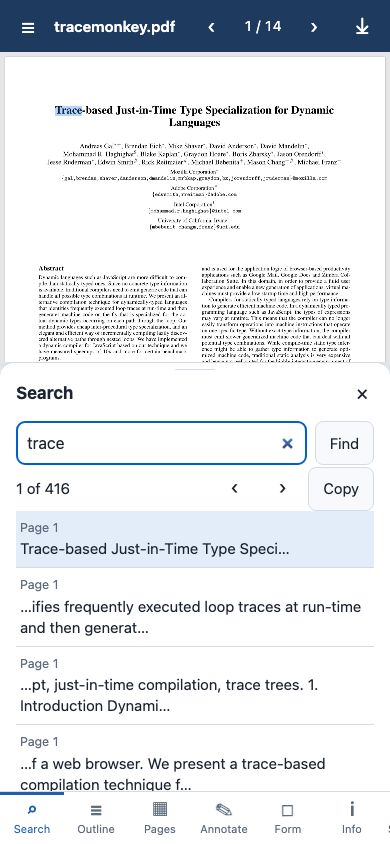
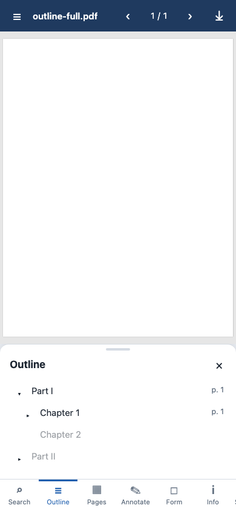
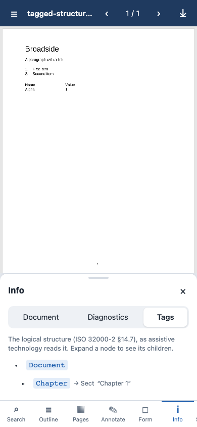
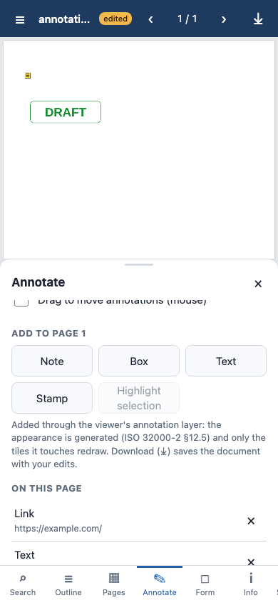
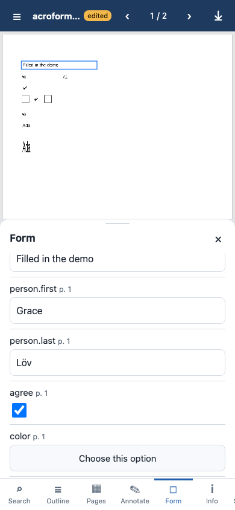
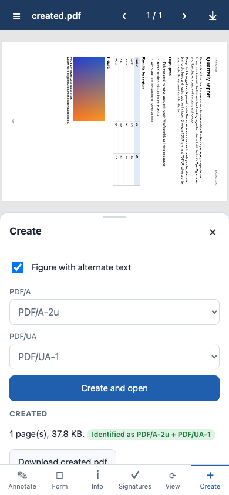
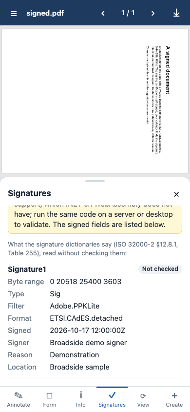

# Broadside Blazor WebAssembly demo

A static web app that shows Broadside end to end in the browser: every byte of PDF work (parsing, rendering, text extraction, editing,
layout, PDF/A and PDF/UA output) runs in WebAssembly, in managed code, with no server. It is built on the `PdfViewer` component of
`Broadside.Viewer.Blazor` (#221) and made for phones first: at 390 px the tools open as bottom sheets, and above 900 px as a drawer
beside the page.

The documentation site hosts it, compiled ahead of time: **<https://michaelstonis.github.io/Broadside/demo/>**.

## Run it

```sh
dotnet run --project samples/Broadside.Viewer.Blazor.Sample          # debug, interpreted, http://localhost:5xxx
samples/Broadside.Viewer.Blazor.Sample/publish-static.sh out/demo    # trimmed + AOT static site in out/demo
```

Serve the folder with any static file server (`python3 -m http.server -d out/demo`) and open it. The site uses only relative
addresses, so it works from any sub-path (`https://example.com/some/folder/`). AOT needs the wasm-tools workload
(`dotnet workload install wasm-tools`).

## Walkthrough

The gallery (☰) opens with the representative sample documents (`samples/documents`, #363): a textbook chapter, a catalogue
with full-bleed photographs, a newsletter, a paper with equations, two invoices, a print-ready brochure, a dictionary, a feature
showcase with layers and a novel in three editions, made by WeasyPrint, headless Chrome and Broadside itself. The textbook opens at
start. Then come pdf.js's TraceMonkey paper, a real-world 14-page file read from pdf.js's own copy (see "Documents and licences"), and
hand-written files from the test corpus, one feature each. You can also open a PDF from your device (it stays in the browser) or from a URL, which is read through HTTP range
requests, so page 1 of a linearized file shows before the rest arrives (the server must allow cross-origin range requests).

| | | |
|---|---|---|
|  |  |  |
| **Search.** Text in reading order from the viewer's selection model; each match is selected and scrolled into view. Copy it, or drag with a mouse to extend it. | **Outline.** Bookmarks resolved to their pages (destinations and GoTo actions, named destinations included). **Pages** shows thumbnails rendered by the same rasterizer. | **Info.** Version, metadata, PDF/A and PDF/UA identification, the reader's diagnostics (what it repaired), and the tag tree as assistive technology reads it. |
|  |  |  |
| **Annotate.** Add a note, box, text, stamp, or a highlight over the selected text; list and remove annotations. Only the tiles an edit touches redraw. | **Form.** Fill text fields, check boxes, radio buttons and choices; tapping a field in the page opens it here. ⤓ downloads the document with your edits. | **Create.** A report laid out with the flow layout package (headings, list, table, figure, link, header and footer), tagged by construction and saved as PDF/A-2u, -3u, -4 and PDF/UA-1 or -2. |

**View** switches the page layout (continuous, single page, two-up, horizontal), rotates the view and zooms; pinch, double-tap,
Ctrl/⌘ + wheel and the keyboard work in the page as well. Its **Renderer** switch draws the tiles with WebGL 2 on the GPU instead of
the managed software rasterizer (#353; `?renderer=webgl` starts that way) and shows the GPU, the tile count, the mean tile time and
how many tiles fell back to the rasterizer; see `docs/benchmarks/viewer-gpu-vs-software.md` for what it changes. **Signatures** validates signed fields where the runtime can: .NET on
WebAssembly has no X.509 support, so in the browser the panel lists what each signature dictionary says, unchecked, and says why
(the same code validates on a server or desktop).

Content tiles are drawn by the **render worker** (#357): `Program.cs` serves tiles when the app boots a second time inside a Web
Worker, and each document the demo opens is sent there, so the page's thread only composes tiles and draws annotation and form
overlays while you scroll. It needs no cross-origin isolation (any static host works); `?worker=0` draws every tile on the page's
thread instead, to compare.



The screenshots come from the browser tests (`BROADSIDE_BROWSER_SCREENSHOTS=<folder>`, Chromium at 390 × 844).

## Publishing for static hosts

`publish-static.sh [--no-aot] [--runtime-folder <name>] <folder>` writes the site and prints its file count, total size and largest file.

| | Files | Size | Largest file |
|---|---|---|---|
| default (trimmed, AOT) | 92 | about 53 MB | `dotnet.native.wasm`, 24.5 MB |
| `--no-aot` | 92 | 31.3 MB | `catalogue.pdf`, 8.1 MB (then `Broadside.Fonts.Standard14.wasm`, 4.4 MB) |

Sizes include the 17 MB of gallery documents, which a browser downloads only when one is picked. A host that compresses responses
sends about a quarter of the rest.

- **Per-file size limits.** `--no-aot` skips ahead-of-time compilation: the IL runs in the .NET interpreter (slower pages, a much
  smaller runtime), so no file comes near a 16 MB per-file limit. It builds in its own `obj/noaot` and `bin/noaot` folders, because a
  non-AOT build over AOT intermediates produces a runtime that fails at startup. The MSBuild switch is `-p:BroadsideAot=false`.
- **Hosts that reserve paths starting with `_`.** `--runtime-folder framework` (MSBuild: `-p:BroadsideRuntimeFolder=framework`) moves
  `_framework` to `framework/` and `_content` to `framework-content/` after publishing, and points `index.html` at them. Blazor has no
  setting for the folder name, so the sample relies on two standard browser mechanisms: `wwwroot/js/start.js` starts Blazor with a
  `loadBootResource` callback that maps every runtime address under `_framework/` to the folder `index.html` loaded
  `blazor.webassembly.js` from (the runtime resolves everything else relative to `dotnet.js`), and an import map
  (`{ "imports": { "./_content/": "./framework-content/" } }`, written into `index.html`) sends the viewer's JavaScript module import
  to the renamed folder.
- **No precompressed files.** The site has no `.br`/`.gz` copies; any host that serves `.wasm` as `application/wasm` works.
- **GitHub Pages.** The documentation workflow (`.github/workflows/docs.yml`) publishes the demo into the documentation site's
  `demo/` folder and deploys both together on every push to `main`: trimmed and AOT-compiled. Pages serves `_framework/` as it is (no Jekyll for an Actions deployment) and needs no cross-origin isolation headers, because
  the demo uses no WebAssembly threads.

## Documents and licences

- TraceMonkey: "Trace-based Just-in-Time Type Specialization for Dynamic Languages" (Gal et al., PLDI 2009), the default document
  of pdf.js. pdf.js's Apache-2.0 licence covers pdf.js, not this paper: its first page carries the ACM's copyright notice
  ("Copyright 2009 ACM"), which allows copies for personal or classroom use and requires permission "to republish, to post on servers
  or to redistribute to lists". So neither this repository nor any build of the demo carries it: the
  gallery reads it (1,016,315 bytes) from pdf.js's own copy at
  <https://mozilla.github.io/pdf.js/web/compressed.tracemonkey-pldi-09.pdf>, which Mozilla serves with
  `Access-Control-Allow-Origin: *`, so opening it needs a network connection.
- The sample documents (`catalogue.pdf`, `textbook.pdf`, the novels and the rest) are linked from `samples/documents/pdf`. Their text
  is written for the project or in the public domain in the United States, their images are public-domain NASA, USFWS and NPS
  photographs, and their fonts are under the SIL Open Font License; `samples/documents/MANIFEST.md` lists every source.
- `signed.pdf`: written by Broadside and signed with `PdfCertificateSigner` (PAdES, `ETSI.CAdES.detached`, SHA-256) by a self-signed
  demo certificate, so a validator finds it intact but its signer untrusted. It embeds subsets of Liberation Sans and Liberation Sans
  Bold (SIL Open Font License 1.1, which allows embedding in documents).
- Every other document is linked from `tests/Corpus` (Broadside's own hand-written files, MIT): written by `tests/Corpus/generate.py`,
  except `linearized.pdf`, which is qpdf's linearization of the corpus's `page-tree-inherited.pdf`. None of them embeds a font
  program (they name Helvetica and ZapfDingbats, which the demo draws with the bundled Standard 14 fonts, Liberation and PDFium's
  Foxit fonts; see `src/Broadside.Fonts.Standard14/THIRD-PARTY-NOTICES.txt`).
